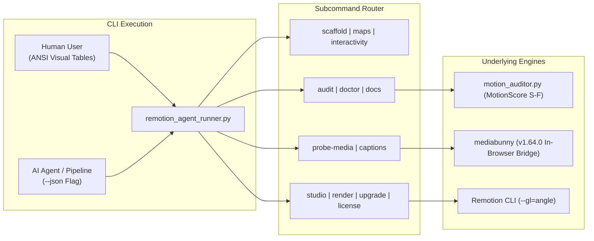

# Unified Remotion Runner CLI — Complete User Guide & Operator Manual

**Tool Path:** `scripts/remotion_agent_runner.py`  
**Runtime:** Python 3.10+ & Node.js 18+  
**Target Engine:** Remotion v4.0.541+ with 35+ companion libraries & `mediabunny` v1.64.0  

---

## 1. Overview & Architecture

The **Unified Remotion Runner CLI** (`scripts/remotion_agent_runner.py`) is the centralized orchestrator for your motion graphics pipeline. It bridges Python-based automation, media pipelines, and DaVinci Resolve workflows with Remotion's React-based video rendering engine.

It consolidates all **13 installed Remotion skills** (from `.agents/skills/`) and **35+ `@remotion/*` packages** into a unified multi-subcommand CLI.



### Core Design Principles
1. **Dual Output Format**: High-contrast, formatted ANSI card output by default for human developers; structured, machine-parsable JSON output via `--json` for automated agent loops.
2. **Strict Project Sandboxing**: Projects created with `--project <name>` reside safely inside gitignored `projects/<name>/` directories, preventing client video assets from polluting version control.
3. **GPU-Accelerated Rendering**: All render pipelines strictly inject hardware-accelerated WebGL flags (`--gl=angle`) to prevent software rasterizer CPU bottlenecks.
4. **Deterministic Motion Hygiene**: Automated auditing blocks non-deterministic APIs (`Math.random()`, `Date.now()`) and layout reflow properties (`top`, `left`, `width`, `height`).

---

## 2. Command Cheatsheet

| Subcommand | Core Skill | Primary Syntax | Key Output |
| :--- | :--- | :--- | :--- |
| `doctor` | `remotion-best-practices` | `python scripts/remotion_agent_runner.py doctor` | Workspace environment & dependency health audit |
| `scaffold` | `remotion-create` | `python scripts/remotion_agent_runner.py scaffold <Name> [--format 9x16\|16x9]` | React scene template + auto-registration in `src/index.ts` |
| `audit` | `remotion-markup` | `python scripts/remotion_agent_runner.py audit [path] [--fix]` | MotionScore Grade (S to F) & layout thrashing analysis |
| `probe-media` | `remotion-multimedia` | `python scripts/remotion_agent_runner.py probe-media <file>` | Millisecond duration, dimensions & codec metadata |
| `captions` | `remotion-captions` | `python scripts/remotion_agent_runner.py captions <audio_file>` | Word-level `Caption[]` JSON for kinetic subtitle pop |
| `maps` | `remotion-maps` | `python scripts/remotion_agent_runner.py maps --type <technique>` | Scaffolds MapLibre, Mapbox, or Cesium 3D camera maps |
| `interactivity` | `remotion-interactivity` | `python scripts/remotion_agent_runner.py interactivity <file>` | Wraps components in `Interactive.Div` + Zod schemas |
| `studio` | `remotion-studio` | `python scripts/remotion_agent_runner.py studio [--port 3000]` | Interactive preview server on `localhost:3000` |
| `render` | `remotion-render` | `python scripts/remotion_agent_runner.py render <CompositionId>` | Hardware-accelerated MP4/ProRes headless export |
| `upgrade` | `remotion-upgrade` | `python scripts/remotion_agent_runner.py upgrade [--dry-run]` | Syncs all 35+ `@remotion/*` dependencies from npm |
| `docs` | `remotion-docs` | `python scripts/remotion_agent_runner.py docs <query>` | Offline/online API search for Remotion components |

---

## 3. Subcommand Specifications & Usage

### 3.1 `doctor` — Workspace Diagnostics & Environment Check
Performs a deep diagnostic of the Remotion environment, checking Node.js, npm, installed `@remotion/*` package version alignment, WebGL acceleration capability, and project directory structure.

```bash
# Human readable report
python scripts/remotion_agent_runner.py doctor

# Agent JSON report
python scripts/remotion_agent_runner.py doctor --json
```

**JSON Output Format:**
```json
{
  "status": "success",
  "subcommand": "doctor",
  "data": {
    "nodeVersion": "v20.11.0",
    "remotionVersion": "4.0.541",
    "packageCount": 35,
    "packagesInSync": true,
    "webGlRenderer": "ANGLE (Direct3D11)",
    "workspaceClean": true
  },
  "errors": []
}
```

---

### 3.2 `scaffold` — Composition & Project Generator
Scaffolds a new production composition compliant with Canva-style minimalist aesthetics, kinetic cards, and high-performance React markup.

```bash
# Scaffold a vertical (9:16) composition in the active workspace
python scripts/remotion_agent_runner.py scaffold Scene01Intro --format 9x16

# Scaffold an isolated client project in projects/client_a/
python scripts/remotion_agent_runner.py scaffold CloudExplainer --project client_a --format 16x9 --fps 30 --duration 15
```

#### Flags:
- `--format`: Aspect ratio (`9x16` [1080x1920], `16x9` [1920x1080], or `1x1` [1080x1080]). Default: `16x9`.
- `--project <name>`: Directory under `projects/` for isolated work. Omit to scaffold directly into `src/`.
- `--fps`: Frame rate (default: `30`).
- `--duration`: Duration in seconds (default: `10`).
- `--no-register`: Suppresses auto-injection into `src/index.ts`.

---

### 3.3 `audit` — MotionScore & GPU Markup Linter
Analyzes TSX/JSX composition code for motion performance bottlenecks.

```bash
# Audit all compositions in src/
python scripts/remotion_agent_runner.py audit

# Audit a specific component file
python scripts/remotion_agent_runner.py audit src/components/kinetics/HardDrive3DWidget.tsx

# Auto-remediate deprecated imports
python scripts/remotion_agent_runner.py audit src/ --fix
```

#### What It Checks:
1. **Layout Thrashing**: Warns if layout properties (`width`, `height`, `top`, `left`, `margin`) are animated directly instead of `transform: translate3d() / scale()`.
2. **Frame Determinism**: Rejects `Date.now()`, `Math.random()`, or `setTimeout()` inside renders.
3. **Small Component Isolation**: Flags root compositions that subscribe to `useCurrentFrame()` instead of extracting child components.

---

### 3.4 `probe-media` — Instant Media Metadata (Mediabunny Bridge)
Uses `mediabunny` (v1.64.0) via an in-memory Node bridge to extract media properties instantly without spawning slow FFmpeg sub-processes.

```bash
# Inspect audio duration and channels
python scripts/remotion_agent_runner.py probe-media assets/audio/voiceover.mp3

# Inspect video dimensions and framerate
python scripts/remotion_agent_runner.py probe-media assets/broll/datacenter.mp4 --json
```

**JSON Output Format:**
```json
{
  "status": "success",
  "subcommand": "probe-media",
  "data": {
    "file": "assets/broll/datacenter.mp4",
    "durationSeconds": 12.45,
    "durationFrames30Fps": 374,
    "width": 1920,
    "height": 1080,
    "aspectRatio": "16:9",
    "codec": "h264",
    "hasAudio": true
  }
}
```

---

### 3.5 `captions` — Word-by-Word Kinetic Subtitle Generator
Ingests audio voiceover files and transforms them into standard `@remotion/captions` `Caption[]` JSON with millisecond start/end timestamps, feeding directly into `KineticSubtitleEngine.tsx`.

```bash
# Generate captions from voiceover audio
python scripts/remotion_agent_runner.py captions assets/voiceovers/scene1.mp3 --out src/captions/scene1.json

# Transcribe with custom confidence threshold
python scripts/remotion_agent_runner.py captions assets/voiceovers/scene1.mp3 --confidence 0.85
```

---

### 3.6 `maps` — Geographic B-Roll & Route Scaffold
Scaffolds animated geographic map compositions based on the 5 supported Remotion Map techniques:

```bash
# 1. MapLibre (100% Free, Vector Tiles, Route Drawing)
python scripts/remotion_agent_runner.py maps --type maplibre --out src/components/maps/ServerClusterMap.tsx

# 2. Mapbox (3D Buildings, Globe Zoom-out)
python scripts/remotion_agent_runner.py maps --type mapbox --style dark --out src/components/maps/GlobeTravel.tsx

# 3. CesiumJS (3D Flight Flythrough over terrain)
python scripts/remotion_agent_runner.py maps --type cesium --out src/components/maps/TerrainFlyover.tsx
```

---

### 3.7 `interactivity` — Remotion Studio Schema Injector
Inspects a React component, identifies editable styles and text nodes, and generates `Interactive.Div` wrappers alongside a Zod schema so the component can be dynamically tweaked in the Remotion Studio UI.

```bash
python scripts/remotion_agent_runner.py interactivity src/components/kinetics/AeroDialog3DWidget.tsx
```

---

### 3.8 `studio` — Interactive Preview Server
Launches the Remotion Studio preview server on Windows safely, ensuring proper terminal detachment and hot-reload.

```bash
# Start studio on standard port (3000)
python scripts/remotion_agent_runner.py studio

# Start on custom port without opening browser
python scripts/remotion_agent_runner.py studio --port 3100 --no-open
```

---

### 3.9 `render` — GPU-Accelerated Production Export
Executes headless rendering with hardware-accelerated WebGL (`--gl=angle`), optimized CPU concurrency, and codec selection.

```bash
# Render a specific composition to MP4
python scripts/remotion_agent_runner.py render IncrementalBackupVertical-Master --out out/master/incremental_backup_vertical.mp4

# Render with JSON props and ProRes 4444 codec
python scripts/remotion_agent_runner.py render ServerRackAnimation --codec prores --prores-profile 4444 --props '{"theme": "dark"}'
```

---

### 3.10 `upgrade` — Synchronized Dependency Upgrader
Scans `package.json` for all 35 `@remotion/*` packages and updates them in lockstep from npm to eliminate version drift and API mismatches.

```bash
# Dry run: check which packages have updates
python scripts/remotion_agent_runner.py upgrade --dry-run

# Execute upgrade
python scripts/remotion_agent_runner.py upgrade
```

---

### 3.11 `docs` — Offline & Online Remotion Knowledge Search
Searches local reference guides in `.agents/skills/` and online Remotion documentation for components, hooks, and easing functions.

```bash
python scripts/remotion_agent_runner.py docs "spring physics config"
```

---

## 4. Real-World End-to-End Walkthroughs

### Walkthrough 1: Creating a Vertical Explainer with Kinetic Subtitles
1. **Probe Voiceover Audio Duration**:
   ```bash
   python scripts/remotion_agent_runner.py probe-media assets/scene1_vo.mp3
   # Result: 14.2 seconds -> 426 frames at 30 FPS
   ```
2. **Generate Word-Level Captions**:
   ```bash
   python scripts/remotion_agent_runner.py captions assets/scene1_vo.mp3 --out src/captions/scene1.json
   ```
3. **Scaffold Vertical Scene**:
   ```bash
   python scripts/remotion_agent_runner.py scaffold Scene01Explainer --format 9x16 --duration 14.2
   ```
4. **Audit Performance**:
   ```bash
   python scripts/remotion_agent_runner.py audit src/scenes/Scene01Explainer.tsx
   # Result: Grade S (100 / 100), 0 Layout Thrashing, 0 Deprecations
   ```
5. **Render Headless Video**:
   ```bash
   python scripts/remotion_agent_runner.py render Scene01Explainer --out out/scene1_render.mp4
   ```

### Walkthrough 2: Generating an Anime Story Scene (Genre 5)
1. **Prepare Story Markdown (`story.md`)**:
   Define characters, camera directions, and dialogue in standard markdown.
2. **Execute Multi-Genre Router**:
   ```bash
   python scripts/video_engine_router.py --genre anime --script inputs/sample_anime_story.md --project CyberSamurai
   ```
3. **Inspect Produced Assets**:
   - Multi-character dialogue mastered to EBU R128 (-16 LUFS) with Faster-Whisper word timestamps.
   - Headless Blender 4.2.3 NPR cel-shaded 3D scene (`out/anime/CyberSamurai/anime_scene.blend`).
   - DaVinci Resolve multi-track FCPXML timeline (`out/resolve_exports/`).
   - Remotion anime speed lines & stylized subtitles preview (`AnimeShowcase-16x9`).

---

## 5. Troubleshooting & FAQ

### Q: Why does Remotion fail with WebGL or GPU crashes during render?
**A:** Always use `--gl=angle` on Windows. The runner enforces this flag automatically on all `render` commands to route WebGL calls through DirectX 11.

### Q: How do I ensure my client project does not get pushed to GitHub?
**A:** Use the `--project <client_name>` flag when running `scaffold`. This automatically creates the project under `projects/<client_name>/`, which is protected by the root `.gitignore`.

### Q: How do I resolve `TypeError: mediabunny is not a function`?
**A:** `mediabunny` is an ES module. The runner uses a dedicated Node bridge script (`scripts/mediabunny_probe.mjs`) with `.mjs` extension to guarantee proper ESM loading.
